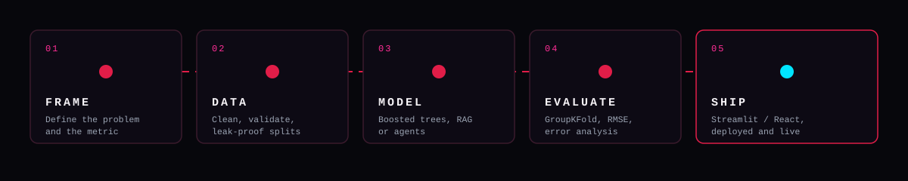
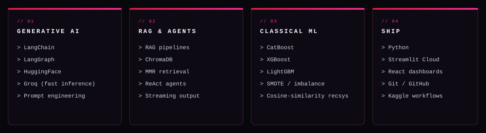

<div align="center">


<a href="https://github.com/Kushagra524"></a>

[](https://github.com/Kushagra524)
[](https://linkedin.com/in/kushagra-srivastava-19a170332)
[](https://kaggle.com/kushagrasrivastava21)
[](https://leetcode.com/kushagra_20)
[](mailto:kushagrasrivastava524@gmail.com?subject=Project%20inquiry)


</div>


## ⚔️ The Mission

> *A blade is judged by what it cuts, not how it looks.* I build AI systems the same way: **GenAI apps, RAG pipelines, agents and predictive models that run in production**, not notebooks that die on a laptop.

Open for **freelance & contract work**. If you have a messy problem and need a working, deployed answer, [send me a message](mailto:kushagrasrivastava524@gmail.com?subject=Project%20inquiry).


## 🥷 Contracts I Take

| Technique | What you get | Proof |
|---|---|---|
| **RAG & document chat** | Chat over your PDFs/knowledge base with retrieval you can trust | *Conversational PDF Chat*, *Di-Still AI Summarizer* |
| **AI agents** | Tool-using agents for live web and academic search | *AI Search Engine Agent* |
| **Predictive ML** | Tabular models with leak-proof validation and clear metrics | *US Stock Return Prediction*, *Triage Acuity Predictor* |
| **Ship it** | Streamlit / React front-ends, deployed and shareable | Every project below is live or runnable |


## 🌀 How I Build



## 🗡️ Arsenal




## 🔥 Shipped Work

<table width="100%">
<tr>
<td width="50%" valign="top">

### 📈 US Stock Return Prediction
*Kaggle*

CatBoost with GroupKFold validation, COVID-2020 excluded from training. **RMSE 41.60.**

`CatBoost` `Huber Loss` `GroupKFold`

</td>
<td width="50%" valign="top">

### 📝 Di-Still AI Summarizer
RAG pipeline with streaming output, deployed on Streamlit Cloud.

`LangChain` `Groq` `HuggingFace` `Streamlit`

</td>
</tr>
<tr>
<td width="50%" valign="top">

### 📚 Conversational PDF Chat
Session-aware RAG with multi-PDF support and MMR retrieval.

`ChromaDB` `LangChain` `Streamlit Cloud`

</td>
<td width="50%" valign="top">

### 🔎 AI Search Engine Agent
ReAct agent for live web and academic search.

`LangChain` `Groq` `DuckDuckGo` `Wikipedia` `Arxiv`

</td>
</tr>
<tr>
<td width="50%" valign="top">

### 🏥 Triage Acuity Predictor
Clinical ML on patient vitals, with class-imbalance handling and a React dashboard.

`LightGBM` `SMOTE` `React`

</td>
<td width="50%" valign="top" align="center">

<br/>

[](https://github.com/Kushagra524?tab=repositories)

</td>
</tr>
</table>


## 📡 Live Signal

<div align="center">


<br/><br/>

[](https://github.com/Kushagra524)


</div>

<details>
<summary><b>🐍 Contribution snake</b> (click to unleash)</summary>

<div align="center">

</div>

</details>


## 📜 Mission Log

```text
[completed]  ML Intern — Cognifyz Technologies
             ├─ restaurant recommender (cosine similarity)
             └─ multi-class cuisine classifier

[completed]  ML Intern — Prodigy InfoTech
             └─ applied machine learning tasks

[ongoing]    LeetCode — daily practice  →  leetcode.com/kushagra_20
[ongoing]    Kaggle   — competitions    →  kaggle.com/kushagrasrivastava21
```

## 🏯 Certifications

<details open>
<summary><b>6 credentials</b></summary>
<br/>

| Certificate | Issuer | Domain |
|---|---|---|
| **Generative AI with LangChain + HuggingFace** *(57.5 hrs)* | Udemy · Krish Naik | GenAI · LLMs · RAG |
| **Generative AI and ChatGPT** | GeeksforGeeks | GenAI |
| **Data Science Bootcamp** | GeeksforGeeks | ML · Data Science |
| **Python Programming** | GeeksforGeeks | Core Python |
| **ML Internship Completion** | Prodigy InfoTech | Applied ML |
| **ML Internship Completion** | Cognifyz Technologies | Applied ML |

</details>


<div align="center">

### `> have a project? let's cut through it.`

[](mailto:kushagrasrivastava524@gmail.com?subject=Project%20inquiry)
[](https://linkedin.com/in/kushagra-srivastava-19a170332)
[](https://kaggle.com/kushagrasrivastava21)

*building systems that ship, one commit at a time. 🌸*

</div>
